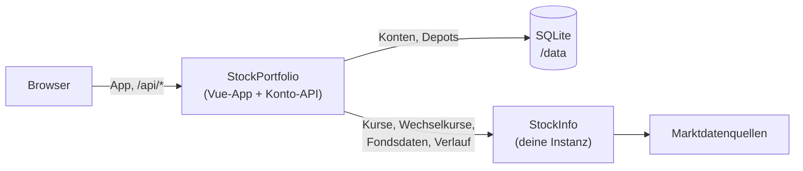

<div align="center">


# StockPortfolio

**Selbst gehostete Depotverwaltung mit Rebalancing nach Toleranzbändern.**

[English](README.md) · Deutsch

[](CHANGELOG.md)
[](https://hub.docker.com/r/mangolila/stockportfolio)
[](LICENSE)

[Funktionen](#funktionen) · [StockInfo](#schwester-app-stockinfo) · [Schnellstart](#schnellstart) · [Konfiguration](#konfiguration) · [Benutzerhandbuch](docs/user-guide.md) · [Docker-Anleitung](docker/README.md)

</div>

StockPortfolio ersetzt die Rebalancing-Tabelle. Du legst Zielanteile und
Toleranzbänder fest; die App bewertet deine Bestände mit aktuellen Kursen und
zeigt, welche Positionen ihr Band verlassen haben und wie viele Stück du kaufen
oder verkaufen musst, um wieder auf Ziel zu kommen.

Sie richtet sich an Privatanleger, die zu Hause einen eigenen Server betreiben.

Die Kurse kommen von der Schwester-App
[StockInfo](https://github.com/MikeMitterer/stockinfo), die du selbst betreibst.


_Das Dashboard: oben die Depotgruppen, darunter die Positionen. Jede Zeile
zeigt Bestand, Ziel- und Ist-Anteil und die nötige Änderung in Stück. Pfeile
markieren Positionen unter (↓) oder über (↑) ihrem Band. Der Screenshot zeigt
das eingebaute Beispiel-Depot mit Testkursen._

> [!WARNING]
> Stelle StockPortfolio und StockInfo nicht ins Internet. Betreibe beide nur im
> Heimnetz und greife von außen über ein VPN zu, zum Beispiel WireGuard oder
> Tailscale.

## Funktionen

- **[Dashboard und Depotgruppen](#dashboard-und-depotgruppen)** – Positionen in sechs Gruppen mit Ziel- und Ist-Anteil, Bandstatus und nötiger Änderung in Stück.
- **Toleranzbänder und Termine** – Rebalancing, wenn eine Position ihr Band verlässt, zu festen Terminen oder beides.
- **[Rebalancing-Simulation](#rebalancing-simulation)** – Geschäfte durchspielen und Kosten, resultierende Anteile und die Finanzierung des Plans sehen. Gebucht wird nichts.
- **[Positionsdetails und Kursverlauf](#positionsdetails-und-kursverlauf)** – Kurschart von einem Monat bis „Max“, Bewertung und Fondsdaten wie TER und Volatilität.
- **[Sicherheitspuffer und Investitionsreserve](#berechnung-sicherheitspuffer-und-investitionsreserve)** – ein Barpolster behalten und sehen, wie viel frei investierbar ist.
- **Mehrere Depots** – jedes mit eigener Basiswährung, eigenen Beständen, eigener Instrumentauswahl und eigenen Einstellungen.
- **Währungsumrechnung** – Fremdwährungskurse werden mit Wechselkursen aus StockInfo umgerechnet; veraltete Kurse werden markiert, fehlende schließen die Position aus.
- **Wertverlauf** – täglich aufgezeichnete Depotwerte und ein Rückblick auf die heutigen Bestände zu früheren Kursen.
- **[Konten und Benutzerverwaltung](#konten-und-benutzerverwaltung)** – jedes Konto hat eigene Depots auf deinem Server.
- **Live-Abgleich** – offene Browser desselben Kontos aktualisieren sich gegenseitig, ohne neu zu laden.
- **Backup und Wiederherstellung** – JSON-Export je Depot; beim Einspielen zeigt die App den Inhalt und fragt vor dem Überschreiben nach.
- **Deutsch und Englisch, helle und dunkle Themes, Leseansicht für Mobilgeräte.**

## Die wichtigsten Funktionen

### Dashboard und Depotgruppen

Im Dashboard arbeitest du täglich. Die Positionen sind in ETFs, Aktien,
Anleihen, Edelmetalle, Geldmarkt und Cash gruppiert. Zu jeder Position siehst
du Bestand, Ziel- und Ist-Anteil, ob sie ihr Band verlassen hat und wie viele
Stück sie zurückbringen würden.

Bestände und Ziele lassen sich direkt in der Tabelle bearbeiten.

Bänder beziehen sich auf das Ziel: Bei 10 % Ziel und 6 % unterem Band löst die
Position bei 9,4 % aus.

### Rebalancing-Simulation


Unter _Rebalancing_ übernimmst du vorgeschlagene Geschäfte oder gibst eigene
Stückzahlen und Probe-Zielanteile ein. Der Plan zeigt die Kosten, die
resultierenden Anteile und Bänder und ob das Geld reicht. Reicht es nicht,
schlägt _Decken aus_ liquide Positionen zum Verkauf vor.

> [!NOTE]
> Rebalancing ist eine Simulation. Die App führt keine Orders aus und prüft
> nicht, ob ein Geschäft für dich geeignet ist.
>
> Gib die Orders bei deiner Bank auf und trage danach die Bestände im Dashboard
> nach.

### Positionsdetails und Kursverlauf


Öffne eine Position, um ihren Kursverlauf zu sehen, von einem Monat bis „Max“,
mit Kurs und prozentualer Veränderung auf zwei Achsen.

Der Reiter _Bewertung_ zeigt Marktwert, Ziel und Bänder; _Informationen_ listet
die Daten, die StockInfo für das Instrument liefert, etwa TER, Fondsgröße,
Anbieter und Volatilität.

### Berechnung, Sicherheitspuffer und Investitionsreserve


Unter _Einstellungen → Berechnung_ wählst du, wann rebalanciert wird: nach
Bändern, nach einem festen Termin in Monaten oder beides.

Dort legst du auch das Mindest-Handelsvolumen und den Sicherheitspuffer fest.

Der Sicherheitspuffer ist Geld, das du nie investieren willst.

Die Investitionsreserve zeigt, was übrig bleibt: Geldmarkt und Cash minus
Puffer. Sie dient nur der Information und löst keine Investition aus.

### Konten und Benutzerverwaltung


Konten, Sitzungen und Depots liegen in einer SQLite-Datenbank auf deinem
Server, nicht im Browser.

Du kannst dich von jedem Browser und Gerät aus anmelden und findest dieselben
Depots.

Admins legen Konten unter **Benutzerverwaltung** an und verwalten sie, können
aber die Depots anderer Konten nicht öffnen.

## Schwester-App StockInfo

StockInfo ist ein eigener Dienst, der Marktdaten sammelt. StockPortfolio läuft
nicht ohne ihn: Jeder Kurs, jeder Wechselkurs, jede Fondskennzahl und jeder
Kursverlauf kommt von deiner StockInfo-Instanz.

StockInfo funktioniert auch allein, etwa für Skripte oder Tabellenkalkulationen.



Der Browser spricht nur mit StockPortfolio. Der Server leitet zulässige
StockInfo-Anfragen angemeldeter Benutzer weiter, ohne Cookies. StockInfo
erfährt nichts über deine Bestände.

| | StockInfo | StockPortfolio |
|---|---|---|
| Zweck | Kurse, Kursverlauf, Fondskennzahlen | Depots, Bewertung, Rebalancing |
| Läuft allein | Ja | Nein – braucht StockInfo |
| Repository | [MikeMitterer/stockinfo](https://github.com/MikeMitterer/stockinfo) | [MikeMitterer/stockportfolio](https://github.com/MikeMitterer/stockportfolio) |
| Docker-Image | [`mangolila/stockinfo`](https://hub.docker.com/r/mangolila/stockinfo) | [`mangolila/stockportfolio`](https://hub.docker.com/r/mangolila/stockportfolio) |

## Schnellstart

Du brauchst eine laufende StockInfo-Instanz, die der Container erreicht.

```bash
docker run -d --name stockportfolio \
    -p 8080:8080 \
    --mount type=volume,source=stockportfolio-data,target=/data \
    -e STOCKINFO_API_URL=https://stockinfo.example.com \
    --restart unless-stopped \
    mangolila/stockportfolio:latest
```

1. Den einmaligen Einrichtungscode auslesen: `docker logs stockportfolio`.
2. <http://localhost:8080> öffnen und das erste Admin-Konto anlegen.
3. Positionen hinzufügen oder zum Umsehen das Beispiel-Depot laden.

`STOCKINFO_API_URL` muss **vom Container aus** erreichbar sein; `localhost`
bezeichnet den Container selbst.

Die [Docker-Anleitung](docker/README.md) (englisch) behandelt außerdem Docker
Compose, Daten und Backups, Updates, Reverse Proxys und Fehlersuche.

Für Unraid siehe die [Unraid-Anleitung](unraid/README.md) (englisch).

## Konfiguration

| Einstellung | Standard | Bedeutung |
|---|---|---|
| `STOCKINFO_API_URL` | keiner (Pflicht) | Adresse deiner StockInfo-Instanz, vom Container aus erreichbar. Ohne sie funktioniert die Anmeldung, die Kurse bleiben aber leer. |
| Volume `/data` | – | Konten, Sitzungen, Depots und Tageswerte. Beim Aktualisieren des Containers behalten. |
| Port `8080/tcp` | `8080` | Weboberfläche; auf einen beliebigen Host-Port abbilden. |
| `STOCKPORTFOLIO_PUBLIC_ORIGIN` | – | Genaue Adresse in der Adresszeile des Browsers, wenn ein Reverse Proxy StockPortfolio ausliefert (etwa über HTTPS): Schema, Host und Port, z. B. `https://portfolio.example.com`. Einrichtung und Anmeldung prüfen sie. |
| `STOCKPORTFOLIO_SECURE_COOKIES` | `false` | Auf `true` setzen, wenn der Browser HTTPS verwendet. |

Alle Einstellungen, Hinweise zu Reverse Proxys und die Statusseite beschreibt
die [Docker-Anleitung](docker/README.md#configuration).

## Entwicklung

Einrichtung, Befehle, der Teststack und der Release-Ablauf stehen in der
[Entwicklerdoku](docs/development.md).

## Weitere Dokumentation

- [Benutzerhandbuch](docs/user-guide.md) – wie die App rechnet und wie du jede Seite benutzt
- [Docker-Anleitung](docker/README.md) – Container einrichten, Konfiguration, Backups und Updates (englisch)
- [Unraid-Anleitung](unraid/README.md) – Installation über Unraid Apps (englisch)
- [Changelog](CHANGELOG.md) – Änderungen je Release

## Support

StockPortfolio ist für den Eigengebrauch des Autors entstanden und wird
kostenlos geteilt.

[Issues](https://github.com/MikeMitterer/stockportfolio/issues) und Pull
Requests werden gelesen, ohne Zusage auf Antwort, Fehlerbehebung oder neue
Funktion.

## Lizenz

Copyright © 2026 Michael Mitterer. **MangoLila GmbH** ist Anbieterin und
Lizenzgeberin.

StockPortfolio steht unter der **[EUPL 1.2](LICENSE)**, nur Version 1.2. Sie
erlaubt private und gewerbliche Nutzung, Änderungen, Weitergabe, Verkauf und
Hosting ohne kostenpflichtige Lizenz.

Wer StockPortfolio oder eine geänderte Fassung weitergibt oder als
Netzwerkdienst anbietet, muss die Urheber- und Lizenzhinweise erhalten,
Änderungen kennzeichnen und den zugehörigen Quelltext nach den
Copyleft-Regeln der Lizenz bereitstellen.

Die Gewährleistungs- und Haftungsausschlüsse der EUPL-Artikel 7 und 8 gelten
auch gegenüber Verbrauchern, soweit das Gesetz es zulässt. Zwingende Rechte
bleiben unberührt, darunter die Haftung für Vorsatz, grobe Fahrlässigkeit,
Personenschäden und nach dem Produkthaftungsgesetz. Eine zusätzliche Garantie
wird nicht übernommen.

Kontakt: **office@MangoLila.at**.

Details: [LICENSE](LICENSE) · [Deutscher Lizenztext](LICENSE.de.txt) ·
[Anbieter- und Verbrauchererklärung](LICENSING.md) ·
[Hinweise zu Fremdkomponenten](THIRD_PARTY_NOTICES.md) ·
[Quelltext](SOURCE.md)
