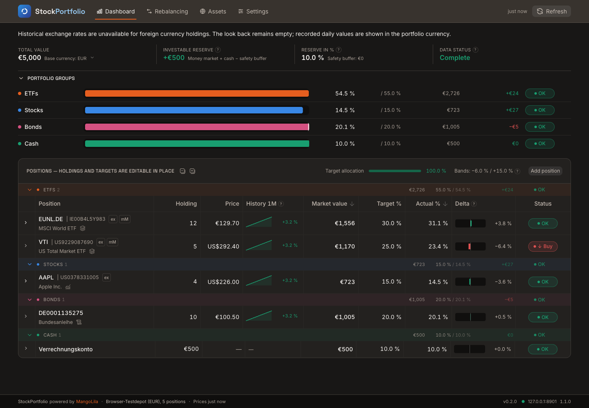
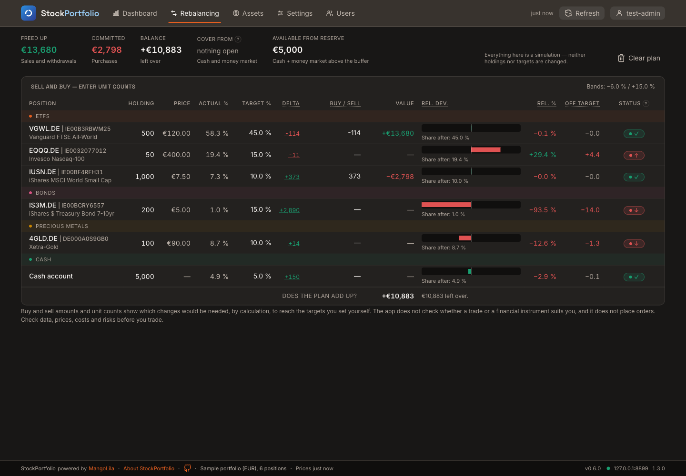
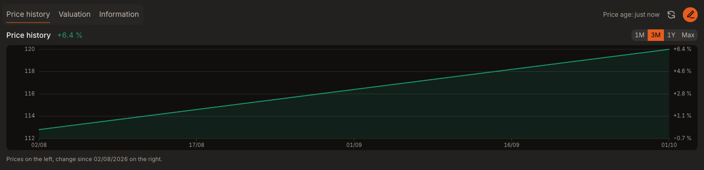
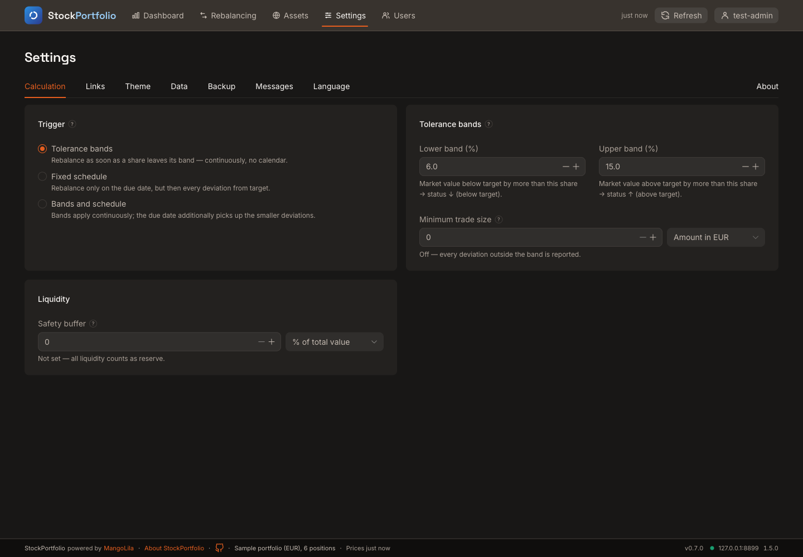
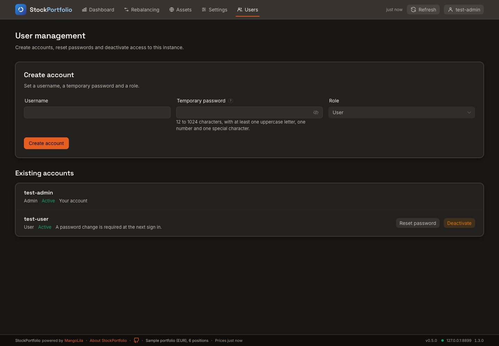
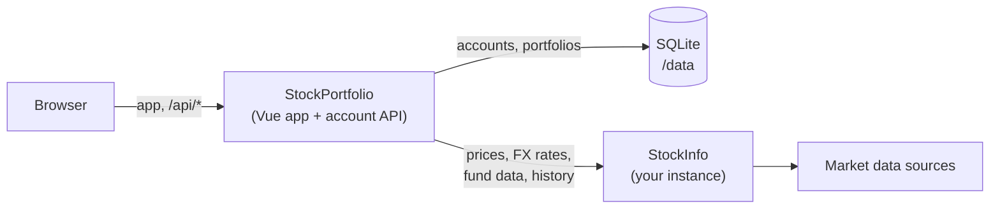

<div align="center">


# StockPortfolio

**Self-hosted portfolio tracking with tolerance-band rebalancing.**

[](CHANGELOG.md)
[](https://hub.docker.com/r/mangolila/stockportfolio)
[](LICENSE)

[Features](#features) · [StockInfo](#sister-app-stockinfo) · [Quick start](#quick-start) · [Configuration](#configuration) · [User guide](docs/user-guide.md) · [Docker guide](docker/README.md)

</div>

StockPortfolio replaces the rebalancing spreadsheet. You set target allocations
and tolerance bands; the app values your holdings with current prices and shows
which positions left their band and how many units to buy or sell to get back on
target.

It is meant for private investors who run their own server at home.

Prices come from its sister app
[StockInfo](https://github.com/MikeMitterer/stockinfo), which you run yourself.



_The dashboard: portfolio groups at the top, positions below. Each row shows
holding, target and actual share and the trade needed in units. Arrows mark
positions below (↓) or above (↑) their band. The screenshot shows the built-in
sample portfolio with test prices._

> [!WARNING]
> Do not expose StockPortfolio or StockInfo to the internet. Run both only in
> your home network and connect from outside through a VPN, for example
> WireGuard or Tailscale.

## Features

- **[Dashboard and portfolio groups](#dashboard-and-portfolio-groups)** – positions in six groups with target, actual share, band status and trade delta in units.
- **Tolerance bands and schedule** – rebalance when a position leaves its band, on a fixed schedule, or both.
- **[Rebalancing simulation](#rebalancing-simulation)** – try trades and see costs, resulting shares and how to fund the plan. Nothing is booked.
- **[Position details and price history](#position-details-and-price-history)** – price chart from one month to "max", valuation and fund data such as TER and volatility.
- **[Safety buffer and investment reserve](#calculation-safety-buffer-and-investment-reserve)** – keep a cash cushion and see how much is free to invest.
- **Several portfolios** – each with its own base currency, holdings, asset selection and settings.
- **Currency conversion** – foreign prices are converted with StockInfo exchange rates; stale rates are flagged, missing ones exclude the position.
- **Value history** – recorded daily portfolio values and a look-back of today's holdings at past prices.
- **[Accounts and user management](#accounts-and-user-management)** – each account keeps its own portfolios on your server.
- **Live sync** – open browsers of the same account update each other without a reload.
- **Backup and restore** – JSON export per portfolio; restore shows the contents and asks before overwriting.
- **German and English, light and dark themes, mobile reading view.**

## Main features

### Dashboard and portfolio groups

The dashboard is the place where you work every day. Positions are grouped into
ETFs, stocks, bonds, precious metals, money market and cash. For each position
you see holding, target and actual share, whether it left its band and how many
units would bring it back.

Holdings and targets can be edited directly in the table.

Bands are relative to the target: a 10 % target with a 6 % lower band triggers
at 9.4 %.

An optional minimum trade size hides small trade amounts, but the deviation
itself stays visible.

### Rebalancing simulation



In _Rebalancing_ you take over suggested trades or enter your own unit counts
and trial target shares. The plan shows the costs, the resulting shares and
bands and whether the money is there. If it is not, _Cover from_ suggests liquid
positions to sell.

> [!NOTE]
> Rebalancing is a simulation. The app does not place orders and does not
> check whether a trade suits you.
>
> Place orders at your bank, then update the holdings on the dashboard.

### Position details and price history



Open a position to see its price history, from one month up to "max", with price
and percentage change on two axes.

The _Valuation_ tab shows market value, target and bands; _Information_ lists
the data StockInfo supplies for that instrument, such as TER, fund size,
provider and volatility.

Daily prices are cached in the browser and fetched at most once a day per
security.

A small sparkline in each row shows at a glance whether the price comes from
above or below.

### Calculation, safety buffer and investment reserve



Under _Settings → Calculation_ you choose when to rebalance: on bands, on a
fixed schedule in months, or both.

Here you also set the minimum trade size and the safety buffer.

The safety buffer is money you never want to invest.

The investment reserve shows what is left: money market and cash minus the
buffer. It is for information only and does not start any investment.

### Accounts and user management



Accounts, sessions and portfolios live in a SQLite database on your server, not
in the browser.

You can sign in from any browser or device and find the same portfolios.

Admins create and manage accounts under **Users**, but they cannot open another
account's portfolios.

## Sister app StockInfo

StockInfo is a separate service that collects market data. StockPortfolio does
not run without it: every price, exchange rate, fund metric and price history
comes from your StockInfo instance.

StockInfo also works on its own, for example for scripts or spreadsheets.



The browser only talks to StockPortfolio. The server forwards permitted
StockInfo requests for signed-in users, without cookies. StockInfo therefore
needs no CORS setting and never learns about your holdings.

| | StockInfo | StockPortfolio |
|---|---|---|
| Purpose | Prices, price history, fund metrics | Portfolios, valuation, rebalancing |
| Runs on its own | Yes | No – needs StockInfo |
| Repository | [MikeMitterer/stockinfo](https://github.com/MikeMitterer/stockinfo) | [MikeMitterer/stockportfolio](https://github.com/MikeMitterer/stockportfolio) |
| Docker image | [`mangolila/stockinfo`](https://hub.docker.com/r/mangolila/stockinfo) | [`mangolila/stockportfolio`](https://hub.docker.com/r/mangolila/stockportfolio) |

## Quick start

You need a running StockInfo instance that the container can reach.

```bash
docker run -d --name stockportfolio \
    -p 8080:8080 \
    --mount type=volume,source=stockportfolio-data,target=/data \
    -e STOCKINFO_API_URL=https://stockinfo.example.com \
    --restart unless-stopped \
    mangolila/stockportfolio:latest
```

1. Read the one-time setup code: `docker logs stockportfolio`.
2. Open <http://localhost:8080> and create the first admin account.
3. Add positions, or load the sample portfolio to look around.

`STOCKINFO_API_URL` must be reachable **from the container**; `localhost` means
the container itself.

The [Docker guide](docker/README.md) also covers Docker Compose, data and
backups, updates, reverse proxies and troubleshooting.

For Unraid, see the [Unraid guide](unraid/README.md).

## Configuration

| Setting | Default | Meaning |
|---|---|---|
| `STOCKINFO_API_URL` | none (required) | Address of your StockInfo instance, reachable from the container. Without it, login works but prices stay empty. |
| `/data` volume | – | Accounts, sessions, portfolios and daily values. Keep it when updating the container. |
| Port `8080/tcp` | `8080` | Web interface; map it to any host port. |
| `STOCKPORTFOLIO_PUBLIC_ORIGIN` | – | Exact address in the browser's address bar when a reverse proxy serves StockPortfolio (e.g. over HTTPS): scheme, host and port, e.g. `https://portfolio.example.com`. Setup and login check it. |
| `STOCKPORTFOLIO_SECURE_COOKIES` | `false` | Set to `true` when the browser uses HTTPS. |

All settings, reverse-proxy notes and the status page are described in the
[Docker guide](docker/README.md#configuration).

## Development

Setup, commands, the test stack and the release process are described in the
[developer guide](docs/development.md).

## Further documentation

- [User guide](docs/user-guide.md) – how the app calculates and how to use each page (German)
- [Docker guide](docker/README.md) – container setup, configuration, backups and updates
- [Unraid guide](unraid/README.md) – installation through Unraid Apps
- [Changelog](CHANGELOG.md) – changes per release

## Support

StockPortfolio is built for its author's own use and shared free of charge.

[Issues](https://github.com/MikeMitterer/stockportfolio/issues) and pull
requests are read, but there is no promise of a reply, a fix or a new feature.

## License

Copyright © 2026 Michael Mitterer. **MangoLila GmbH** is the provider and
licensor.

StockPortfolio is licensed under the **[EUPL 1.2](LICENSE)**, version 1.2 only.
It permits personal and commercial use, changes, redistribution and hosting
without a paid license.

Keep the required notices, mark your changes and follow the license's
source-code and copyleft rules, also for network services.

When dealing with consumers, MangoLila GmbH does not rely on the warranty and
liability exclusions in EUPL Articles 7 and 8; statutory rules apply. No
additional guarantee is given.

Contact: **office@MangoLila.at**.

Details: [LICENSE](LICENSE) · [German license text](LICENSE.de.txt) · [Provider
and consumer declaration](LICENSING.md) · [Third-party
notices](THIRD_PARTY_NOTICES.md)
